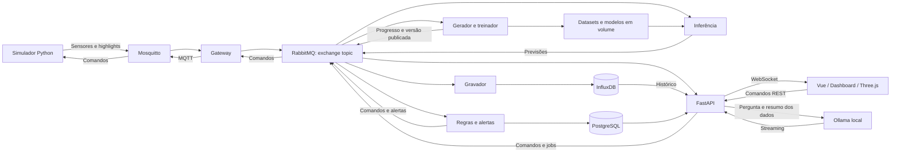

# Implementação do segundo bimestre

## Escopo

O projeto mantém a marcação de highlights de beach tennis e acrescenta os componentes exigidos para a versão AIoT:

- Sensores da quadra: temperatura ambiente, umidade e luminosidade.
- Bebedouro: temperatura da água e compressor com temperatura, corrente e vibração.
- Atuadores: refrigeração automática pela temperatura da água e refletores comandados pela Web.
- Manutenção preditiva: dois regressores para índice de saúde e vida útil restante do compressor.

Os highlights continuam sendo marcações de eventos. Não há captura real de vídeo, diagnóstico de desidratação ou recomendação individual de consumo de água.

## Arquitetura



O novo ponto de entrada é `backend/aiot/app.py`. O Compose executa essa versão; o código do primeiro bimestre e o Wokwi permanecem como referência.

O simulador publica leituras a cada dois segundos. O gateway encaminha os eventos pelo RabbitMQ. Consumidores distintos gravam dados, fazem inferência, aplicam regras e entregam eventos à API. Comandos recebem um ID; a confirmação do simulador usa esse ID e o estado aparece nas leituras seguintes.

PostgreSQL guarda usuários, dispositivos, regras, alertas, auditoria, metadados de datasets, jobs e versões de modelos. InfluxDB guarda as séries de sensores e highlights. Datasets massivos e artefatos ficam em um volume compartilhado, sem misturar dados sintéticos com as séries ao vivo.

## Como subir

Na raiz:

```powershell
docker compose up --build -d
```

Interface: `http://localhost:8080`. O primeiro preparo baixa imagens e o modelo `llama3.2:3b`, e pode demorar. A parte operacional pode abrir enquanto o modelo local é obtido.

```powershell
docker compose ps
docker compose logs --tail 30 model-init
```

O bootstrap gera senhas aleatórias, sem gravá-las no Git. Para consultar as contas de demonstração no seu terminal:

```powershell
docker compose run --rm --no-deps bootstrap cat /secrets/demo-users.txt
```

Usuários: `visualizador`, `operador` e `administrador`. Visualizador acompanha os dados; operador envia comandos; administrador também cadastra dispositivos, altera regras, gera dados, treina modelos e consulta auditoria. As senhas do banco de usuários são hashes bcrypt.

Parar sem apagar dados:

```powershell
docker compose stop
```

## Demonstração na ordem do enunciado

1. Subir o Compose e verificar containers saudáveis.
2. Mostrar login e os três papéis, incluindo operações bloqueadas sem permissão.
3. Mostrar sensores e mensagens MQTT com `docker compose logs --tail 30 simulator gateway mosquitto`.
4. Abrir `http://localhost:8080/docs`; usar o token obtido no login para autorizar o Swagger.
5. Abrir Mensageria, executar `docker compose stop writer` e observar o crescimento da fila; executar `docker compose start writer` e observar a drenagem.
6. Mostrar leituras no InfluxDB e cadastro, regras e auditoria no PostgreSQL; consultar histórico no Dashboard.
7. Mostrar valores e gráficos chegando pelo WebSocket.
8. Ligar refletores pela Web. Mostrar a refrigeração automática: liga acima de 16 °C e desliga abaixo de 10 °C por padrão; limites configuráveis na administração.
9. Gerar o dataset padrão no Laboratório: 100 equipamentos, 60 dias, intervalo de 5 minutos, 1.728.000 amostras e 5.184.000 leituras.
10. Selecionar o dataset concluído em Treinamento, disparar os dois modelos e mostrar métricas, gráficos e comparação com a base simples.
11. Injetar falha no compressor e mostrar medições, saúde, RUL e alertas em Insights e na quadra 3D.
12. Perguntar ao assistente local sobre o compressor, o alerta, as métricas ou o fluxo dos dados.

A cena 3D muda a iluminação ambiente conforme a luminosidade e as nuvens conforme a umidade. Refletores acendem e o compressor anima conforme seu estado e vibração. Depois de dez segundos sem telemetria, as animações dependentes dos dispositivos param e a tela avisa. Clique em um item para ver leitura, gráfico, saúde e comandos permitidos.

## Dados e modelos

O gerador usa NumPy por equipamento/bloco e salva matrizes com memmap. Limites: dois milhões de amostras e vinte milhões de leituras. A contagem de leituras corresponde aos valores dos três tipos de sensor e suas réplicas configuradas.

Na dinâmica `compressor-v2`, cada publicação a cada 2 segundos representa 5 minutos simulados. A RUL é medida em horas de operação simuladas, supondo continuidade da degradação; não é prazo de relógio real. O regressor de RUL é treinado/avaliado somente na degradação observável. Em condição saudável, não há prazo identificado; durante a degradação, estimativas com erro amplo aparecem como baixa confiança. Consulte [a validação v2](validacao-rul-v2-2026-10-20.md) e a [política de exibição atual](validacao-exibicao-rul-2026-10-23.md) antes de apresentar as métricas.

Treino e inferência usam `aiot/features.py`: última leitura, média, desvio, máximo e tendência de uma janela temporal causal de 55 minutos simulados (12 pontos a cada 5 minutos), com temperatura do compressor compensada pelo ambiente e tendências por hora. Ausências são preenchidas causalmente e outliers limitados a faixas físicas amplas. Alvos de saúde e tempo até a falha existem somente no dataset. O simulador não envia desgaste ou rótulos para a IA.

Equipamentos são separados em treino (60%), validação (20%) e teste (20%). Cada conjunto usa até 50 mil amostras para o ajuste/avaliação, preservando o dataset massivo. Dois ExtraTreesRegressor são comparados à média do treino. A versão só entra em uso se ambos vencerem a baseline em MAE de validação e MAE/RMSE de teste. A troca do artefato é atômica; a inferência recarrega sem reiniciar.

Compressor desligado: previsão suspensa e janela reiniciada. Depois de ligar, é necessário completar a janela novamente. As horas de RUL são estimativas do cenário sintético, sem validação em equipamento real.

Alertas abrem após três previsões seguidas com saúde abaixo de 40 ou RUL abaixo de 48 horas; resolvem após dez previsões seguidas fora desses limites. Estado persistido no PostgreSQL.

## Segurança e acesso aos serviços

- JWT em Authorization; WebSocket com ticket curto e de uso único, sem JWT na URL.
- Limites de login por IP e usuário; cinco perguntas por minuto por usuário.
- Logins, perguntas, comandos, cadastro, regras e jobs auditados.
- MQTT autenticado com ACLs e RabbitMQ com credenciais por serviço, filas/exchange e routing keys permitidas.
- Containers da aplicação sem root; só a porta do frontend publicada para a aplicação.
- InfluxDB e gerenciamento do RabbitMQ publicados somente em `127.0.0.1`, com links na aplicação.
- LLM recebe um resumo pronto, sem acesso direto aos bancos. Respostas exibidas como texto, sem HTML, imagens ou ferramentas executáveis.
- Mensagens rejeitadas são preservadas na DLQ; a inspeção mantém as mensagens na fila.

PostgreSQL sem publicar porta:

```powershell
docker compose exec postgres psql -U court -d court -c "SELECT id, name, kind FROM devices;"
docker compose exec postgres psql -U court -d court -c "SELECT username, action, timestamp FROM audit ORDER BY id DESC LIMIT 10;"
```

As credenciais das interfaces administrativas ficam no volume de segredos. Senhas não são documentadas no README. Docker/WSL2 precisa de memória suficiente; o enunciado recomenda pelo menos 8 GB. O Compose limita geração, treino e Ollama para evitar consumo sem teto.

## Verificação reproduzível

Dentro de `backend`, após `uv sync`:

```powershell
uv run python -m unittest discover -s tests -v
```

Frontend:

```powershell
cd frontend
npm ci
npm run build
```

Integração contra serviços reais, criando eventos, um dataset massivo e um treino:

```powershell
docker compose exec api python -m scripts.check_integration
```

As contribuições e commits dos integrantes devem ser reais. A implementação não simula histórico de autoria nem envia alterações automaticamente ao GitHub.
