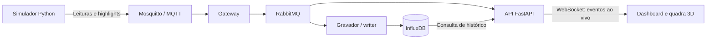
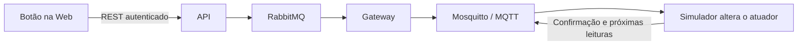
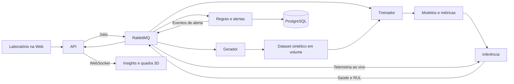

# Roteiro de apresentação — Quadra Inteligente AIoT

Versão de 26/10/2026 · Segundo bimestre · Apresentação prevista para 16/11/2026

Este é o roteiro para conduzir a demonstração com a aplicação aberta. Reserve cerca de **20 minutos**, além das perguntas. Os tempos são uma referência para ensaio: geração, treino, ciclo do compressor e resposta do assistente dependem da máquina e do estado da simulação.

## 1. A ideia que deve ficar clara

> “Nosso projeto monitora uma quadra de beach tennis e a infraestrutura que atende os jogadores. Mantivemos os highlights do primeiro bimestre e acrescentamos sensores, controle de equipamentos, visualização 3D e manutenção preditiva do compressor do bebedouro. A demonstração mostra o dado saindo do dispositivo, chegando à tela e voltando como comando, além da IA analisando as medições.”

A apresentação acontece na aplicação. Este documento serve como apoio para as falas e os comandos, sem exigir slides.

## 2. Entenda os fluxos antes de apresentar

### Fluxo A — Do sensor até a Web



**Fala sugerida:**

> “O simulador Python representa os sensores e atuadores. Ele publica as leituras no Mosquitto usando MQTT. O gateway transforma a comunicação da borda em eventos internos no RabbitMQ. A partir daí, consumidores diferentes trabalham em paralelo: um grava o histórico no InfluxDB e outro entrega os eventos para a API, que atualiza a tela por WebSocket.”

**Ponto para explicar:** o gráfico ao vivo não precisa esperar uma consulta ao banco. O caminho de persistência e o caminho de atualização ao vivo são ramos separados; ao consultar o histórico, a API lê o InfluxDB.

### Fluxo B — Da Web até o atuador



**Fala sugerida:**

> “Quando clicamos para ligar os refletores, a API verifica a permissão e publica o comando no RabbitMQ. O gateway encaminha pelo MQTT até o simulador. O atuador muda de estado e devolve a confirmação; as próximas leituras trazem esse novo estado. A evidência é a confirmação e a mudança que chega à interface.”

### Fluxo C — Dos dados até a previsão de IA



**Fala sugerida:**

> “Primeiro geramos um conjunto de dados sintéticos e treinamos dois modelos: um estima a saúde e outro a vida útil restante durante a degradação. Depois, a inferência aplica os modelos às medições ao vivo e publica as previsões no RabbitMQ. As regras avaliam essas previsões, persistem os alertas e enviam as mudanças para a interface.”

**Diferencie as duas IAs:** os regressores scikit-learn fazem as previsões numéricas. O Ollama é o assistente de linguagem que seleciona informações verificadas pela aplicação para responder às perguntas.

### Onde cada informação fica

| Componente | Responsabilidade | O que mostrar |
|---|---|---|
| Mosquitto / MQTT | Comunicação com o dispositivo simulado | Leituras, comandos e logs |
| RabbitMQ | Distribuição interna de eventos e jobs | Filas, consumidores e mensagens acumuladas |
| InfluxDB | Séries temporais de sensores e highlights | Consulta de histórico e interface do banco |
| PostgreSQL | Usuários, dispositivos, regras, alertas, auditoria, jobs e versões | Administração e consultas SQL |
| Volume de artefatos | Datasets e modelos treinados | Dataset concluído, versão e métricas |
| FastAPI | Autenticação, REST, contexto do assistente e WebSocket | Swagger e atualização da aplicação |
| Vue, ECharts e Three.js | Interface, gráficos e cena 3D | Dashboard, Insights e quadra |

## 3. Prepare antes de entrar em sala

- Prepare o notebook conforme [o guia de instalação e ensaio offline](apresentar-no-notebook.md). Baixe as imagens e o modelo local com antecedência.
- Tenha um dataset concluído e uma versão treinada ativa. Ensaie geração e treino na máquina que será usada; não dependa da conclusão de um treino ao vivo para mostrar as previsões.
- Separe as credenciais de `visualizador`, `operador` e `administrador`, sem projetar a lista de senhas.
- Deixe abertas a aplicação em `http://localhost:8080`, o Swagger em `http://localhost:8080/docs` e um PowerShell na raiz do projeto.
- Confira sensores, conexão WebSocket, Mensageria, versão ativa, inferência e assistente. Antes da fala, verifique se há um alerta ou falha anterior que precise ser explicado ou restaurado.
- Ensaie a injeção de falha e a recuperação. O compressor precisa estar funcionando para acumular desgaste e produzir a janela de inferência.
- Use zoom legível na projeção e mantenha o notebook conectado à tomada.

**Comandos de preparação — antes da apresentação:**

```powershell
docker compose up --build -d
docker compose ps -a
docker compose exec -T ollama ollama list
docker compose exec -T ollama ollama ps
```

`ollama list` confirma que o modelo foi baixado; `ollama ps` mostra os modelos carregados na memória. Se necessário, aqueça o modelo antes da apresentação:

```powershell
docker compose exec -T ollama ollama run llama3.2:3b "Responda pronto."
```

Os serviços de inicialização, como `bootstrap`, `database-init` e `model-init`, podem aparecer encerrados com código zero: são tarefas que terminam após o preparo. Os serviços contínuos devem estar em execução e saudáveis quando possuem healthcheck.

## 4. Ordem da apresentação

| Etapa | Tempo de referência | Tela principal | Evidência |
|---|---:|---|---|
| 1. Problema e evolução | 1 min | Dashboard | O que o projeto resolve |
| 2. Ambiente e acessos | 2 min | Terminal, login e Swagger | Serviços, perfis e API |
| 3. Fluxo IoT → Web | 2 min | Dashboard e Highlights | Leituras, histórico e evento |
| 4. Fluxo Web → IoT | 1 min | Dashboard e Insights | Comando confirmado e início da falha |
| 5. Filas e persistência | 2 min | Mensageria e bancos | Acúmulo, drenagem e dados salvos |
| 6. Laboratório | 2 min | Laboratório | Dataset e job de geração |
| 7. Treinamento | 3 min | Treinamento | Dois modelos, métricas e baseline |
| 8. Previsões e alertas | 3 min | Insights | Saúde, horas, faixa e recuperação |
| 9. Assistente local | 2 min | Assistente e quadra 3D | Resposta e visualização dos dados |
| 10. Falta de dados | 1 min | Quadra 3D | Estado desatualizado e retomada |
| 11. Encerramento | 1 min | Dashboard | Retomada dos três fluxos |

### Etapa 1 — Abra com o problema

**Faça:** deixe o Dashboard aberto e use a fala de abertura da seção 1.

**Aponte:** condições da quadra, bebedouro, refletores e highlights.

**Transição:** “Vou mostrar primeiro como esses dados chegam aqui, depois como controlamos o equipamento e, por fim, como a IA participa.”

### Etapa 2 — Mostre ambiente, permissões e API

**Faça no terminal, com o ambiente já preparado:**

```powershell
docker compose up -d --pull never --no-build
docker compose ps -a
```

**Faça na Web:** entre como `visualizador` e mostre os comandos desabilitados. Depois entre como `operador`, mostre que pode comandar os refletores, e finalize como `administrador`, que também acessa cadastro, regras, geração e treino.

> “A permissão é validada na API. O visualizador acompanha; o operador comanda; o administrador também configura e treina os modelos.”

**Mostre o Swagger:** localize `POST /api/login`, explique a emissão do token e use **Authorize** para testar `GET /api/me`. Se for demonstrar as chamadas, faça a autenticação com as credenciais preparadas, evitando expor senhas na projeção.

**Confira:** o usuário e o papel retornados correspondem à conta usada. Não use o Swagger para disparar novamente os comandos que já vai demonstrar pela tela.

### Etapa 3 — Mostre o fluxo IoT → Web

**Faça:** no Dashboard, aponte leituras mudando e a conexão WebSocket. Consulte um período no histórico. Abra Highlights, registre um highlight e confira o novo evento na lista.

> “As leituras chegam a cada dois segundos. O WebSocket atualiza os valores sem recarregar a página. O histórico vem do InfluxDB. O highlight preserva a proposta do primeiro bimestre: registrar um momento da partida.”

**Mostre rapidamente os logs:**

```powershell
docker compose logs --tail 20 simulator gateway mosquitto
```

**Conecte com o fluxo A:** simulador → MQTT → gateway → RabbitMQ → consumidores. Identifique o ramo que grava e o que atualiza a Web.

### Etapa 4 — Mostre o fluxo Web → IoT e inicie a falha

**Faça:** ligue ou desligue os refletores. Aguarde a confirmação e confira o novo estado no Dashboard e na quadra 3D.

> “O clique percorre o caminho inverso. O comando chega ao simulador e a mudança volta nas leituras seguintes.”

**Mostre a refrigeração automática:** na Administração, aponte a regra e seus limites atuais. Por padrão, liga acima de 16 °C e desliga abaixo de 10 °C. Entre esses limites, mantém o estado anterior.

**Em Insights:** mostre a condição inicial e clique **Injetar falha** uma vez. Confirme o comando e continue a apresentação enquanto a degradação avança.

> “Vou iniciar agora uma falha simulada e voltar às previsões depois. Assim podemos observar a evolução das medições ao longo do tempo.”

**Confira:** o compressor está operando. Se estiver desligado pelo ciclo automático, a degradação fica pausada; não prometa um alerta em um tempo fixo.

### Etapa 5 — Prove a utilidade do RabbitMQ e dos bancos

**Faça:** abra Mensageria, identifique a fila do `writer` e execute:

```powershell
docker compose stop writer
```

Observe a fila por alguns segundos. Mostre a quantidade de mensagens prontas crescendo e a ausência do consumidor. Depois retome:

```powershell
docker compose start writer
```

> “Paramos apenas o gravador. As mensagens continuam chegando ao RabbitMQ e ficam na fila. Quando o consumidor volta, ele processa o acúmulo. Os outros consumidores podem continuar trabalhando.”

**Confira:** a fila drena. Retome o `writer` antes de seguir, mesmo que precise abreviar a explicação. A gravação fica atrasada durante a parada; não afirme que o histórico ficou atualizado nesse intervalo.

**Mostre a DLQ:** como administrador, use **Inspecionar DLQ** e explique que mensagens rejeitadas podem ser preservadas para diagnóstico. Se estiver vazia, mostre esse estado; não é preciso criar um erro durante a apresentação.

**Mostre persistência:** abra o InfluxDB pelo link do rodapé e mostre uma consulta preparada às séries. Para PostgreSQL, execute:

```powershell
docker compose exec -T postgres psql -U court -d court -c "SELECT id, name, kind FROM devices;"
docker compose exec -T postgres psql -U court -d court -c "SELECT username, action, timestamp FROM audit ORDER BY id DESC LIMIT 10;"
```

> “O InfluxDB guarda medições ao longo do tempo. O PostgreSQL guarda cadastros, configurações e registros operacionais, como esta auditoria dos comandos.”

### Etapa 6 — Explique de onde vêm os dados de treino

**Faça:** abra Laboratório, mostre os parâmetros e o dataset concluído no ensaio. Para demonstrar o processamento assíncrono, dispare uma geração e acompanhe seu job; a conclusão pode ocorrer enquanto outras telas são apresentadas.

> “Os dados de treinamento são sintéticos. Simulamos equipamentos com operação, paradas, ruído e falhas. A configuração padrão usa 100 equipamentos por 60 dias, com intervalo de cinco minutos e três canais de medição do compressor.”

**Explique a contagem padrão:**

```text
100 equipamentos × 60 dias × 24 horas × 12 amostras/hora
= 1.728.000 amostras

1.728.000 amostras × 3 canais
= 5.184.000 leituras
```

Os canais são temperatura, corrente e vibração. Os valores de saúde e tempo até a falha são rótulos para treinar e avaliar; o dispositivo ao vivo não envia esses rótulos à inferência.

**Confira:** os números exibidos correspondem à configuração escolhida. Se mudar os parâmetros, não repita a contagem padrão como se ainda fosse válida.

### Etapa 7 — Mostre que os modelos foram treinados e avaliados

**Faça:** em Treinamento, selecione um dataset concluído e dispare o treino. Mostre o progresso e as métricas da versão ativa já preparada. Se o novo job terminar, confira se essa versão foi ativada antes de apresentá-la como a versão em uso.

> “Temos dois regressores ExtraTrees: saúde, de zero a cem, e vida útil restante na fase de degradação. Os equipamentos são separados em treino, validação e teste, nas proporções de 60%, 20% e 20%. Isso evita avaliar o modelo nos mesmos equipamentos usados para ajustar seus parâmetros.”

**Aponte os gráficos e explique três métricas:**

| Métrica | Fala simples |
|---|---|
| MAE | “É o tamanho médio do erro absoluto; quanto menor, melhor.” |
| RMSE | “Penaliza mais os erros grandes; quanto menor, melhor.” |
| R² | “Compara a variação explicada pelo modelo; pode ser negativo quando o resultado é ruim.” |

> “Também comparamos com uma base simples que usa a média do treino. A nova versão só é ativada se os dois modelos passarem pelos critérios de comparação implementados. Treinar não significa ativar automaticamente qualquer resultado.”

**Confira:** versão ativa, selo de comparação e métricas realmente exibidas. Leia os resultados da máquina usada; não memorize números de uma validação antiga.

### Etapa 8 — Explique saúde, horas e alerta sem confundir os valores

**Faça:** volte a Insights e observe a falha iniciada na etapa 4. Mostre a tendência de saúde, as horas, a faixa experimental e os alertas.

> “Saúde descreve a condição estimada agora. As horas têm duas interpretações, identificadas no painel.”

| Estado do painel | Como explicar |
|---|---|
| **Cenário sem falhas** | “É uma referência calculada com a taxa de desgaste natural do simulador. Com saúde exatamente 99/100, corresponde a aproximadamente 16.500 horas de operação, supondo que não surja uma nova falha.” |
| **Estimativa experimental** | “Com degradação observável, o modelo estima as horas restantes se essa degradação continuar. Interpretamos o valor junto com a faixa.” |
| **Baixa confiança** | “O erro observado na validação é amplo. A faixa ajuda a entender essa incerteza; o número não é um prazo garantido.” |
| **Aguardando / previsão suspensa** | “Faltam dados recentes, uma janela completa ou operação do compressor. O painel explica o motivo.” |

Abra **Como interpretar essas horas** apenas para mostrar onde a explicação fica disponível; não leia todo o texto em voz alta.

> “Cada leitura a cada dois segundos representa cinco minutos simulados. As horas são de funcionamento, não de calendário, e as paradas não as consomem. A referência saudável vem da regra física do simulador; a RUL durante a falha vem do modelo. Nenhuma das duas é uma garantia de duração de um compressor real.”

**Explique o alerta:** ele abre após três previsões críticas consecutivas: saúde abaixo de 40/100 ou limite superior da faixa de RUL abaixo de 48 horas, quando há faixa disponível. Ele resolve após dez previsões consecutivas fora das condições críticas. A referência saudável em horas não participa desse limite de RUL.

**Diferencie o selo “Sensores” do alerta preditivo:** um descreve o estado das medições; o outro depende das previsões e da persistência das condições críticas. Os dois não precisam mudar juntos.

**Ainda não apareceu um alerta?** Mostre as medições e a tendência que de fato existem. Na configuração atual, a falha avança até o desgaste total em seis horas de operação simuladas, cerca de 144 segundos reais se o compressor operar continuamente. Paradas e a janela inicial aumentam a espera; isso não garante o instante de abertura de um alerta.

**Guarde a restauração para depois da pergunta ao assistente**, se quiser perguntar sobre o alerta ainda ativo.

### Etapa 9 — Mostre o assistente e use a espera para explicar o 3D

**Faça:** no Assistente, envie uma pergunta ligada ao estado atual:

> “Qual é o estado do compressor e o que significa o alerta?”

Se não houver alerta ativo, use:

> “Qual é a saúde atual do compressor e como devo interpretar a vida útil restante?”

> “O assistente usa um modelo local pelo Ollama. A API prepara os fatos e valores verificados, o modelo seleciona as seções relevantes e a aplicação transmite esses textos para a tela. Ele não consulta diretamente os bancos e não calcula a previsão do compressor.”

**Mostre os estados de espera:** preparando a consulta, carregando o modelo quando necessário e analisando a pergunta. O contador indica tempo decorrido, não percentual concluído. Em CPU, a resposta pode levar cerca de um minuto ou mais.

Enquanto espera, abra **Quadra 3D**: a requisição continua enquanto você navega entre as telas. Mostre iluminação pela luminosidade, nuvens pela umidade, refletores e o compressor. Clique em um dispositivo e confira a leitura no painel lateral.

> “A cena usa a mesma telemetria da aplicação. Ela traduz o estado dos equipamentos em uma visualização que acompanha as mudanças.”

**Volte ao Assistente:** confira os dados e o contexto temporal da resposta. Ela corresponde ao resumo preparado quando a pergunta foi enviada; o equipamento pode ter mudado enquanto o modelo processava. A referência saudável adicionada ao painel não implica que o assistente a apresente como RUL prevista.

**Restaure:** volte a Insights e clique **Restaurar equipamento**. Mostre a recuperação quando houver previsões disponíveis; o alerta pode continuar ativo até completar as dez previsões normais exigidas.

### Etapa 10 — Mostre o comportamento sem dados recentes

**Faça:** com a quadra 3D aberta, execute:

```powershell
docker compose stop simulator
```

Aguarde mais de dez segundos e aponte o aviso de dados antigos e a parada das animações dependentes dos dispositivos. Depois execute:

```powershell
docker compose start simulator
```

> “Quando a telemetria para, a aplicação sinaliza que os dados estão antigos. Ao retomar o dispositivo, as leituras voltam. A previsão precisa de uma nova janela de medições durante a operação.”

**Confira:** os dados voltaram. Reiniciar o simulador também reinicia seu estado interno; não descreva isso como continuidade exata da condição anterior. Esta etapa deve ficar depois da demonstração de falha e recuperação.

### Etapa 11 — Feche retomando os três fluxos

> “Mostramos os sensores chegando à Web, os comandos saindo da Web e alterando os atuadores, e a IA transformando medições em previsões e alertas. O RabbitMQ distribui esses eventos, cada banco guarda o tipo de informação adequado e a interface reúne histórico, operação e visualização 3D. A evolução do primeiro bimestre foi integrar monitoramento, controle e manutenção preditiva na mesma aplicação.”

Se houver perguntas, mantenha o ambiente disponível. Ao terminar a sessão:

```powershell
docker compose stop
```

## 5. Se algo demorar ou falhar durante a apresentação

| Situação | Próxima ação |
|---|---|
| Treino ou geração ainda em execução | Mostre o job e a versão preparada antes do ensaio. Identifique qual versão está sendo exibida e continue nas outras etapas. |
| Modelo novo não ativado | Mostre o resultado da comparação com a baseline e explique que a versão anterior continua ativa. |
| Compressor desligado | Mostre o estado e a regra automática. A previsão é suspensa; aguarde operação e a janela de 12 medições, cerca de 24 segundos de publicação. |
| Alerta não abriu | Confira condição, faixa e operação. Explique a tendência observada; não apresente alerta histórico como se fosse novo. |
| Assistente demora | Mostre o estado e o contador; apresente o 3D enquanto espera e retorne à pergunta. Se houver erro, confira `docker compose logs --tail 30 api ollama`. |
| Fila não cresce ao parar o writer | Confira a fila correta e se há telemetria chegando. Ao concluir, execute `docker compose start writer`. |
| Web mostra dados antigos | Confira `docker compose ps -a` e os logs de `simulator`, `gateway` e `api`; mostre o aviso como estado real do sistema. |
| Docker não está pronto | Abra o Docker Desktop e aguarde o mecanismo iniciar antes de executar Compose. Falhas de WSL são do ambiente e precisam ser resolvidas antes de retomar a demo. |

## 6. Cola rápida para deixar ao lado da aplicação

```text
1. Problema: quadra + highlights + infraestrutura do bebedouro.
2. Compose, três perfis e Swagger.
3. Dashboard ao vivo, histórico e highlight.
4. Refletores: clicar, confirmar e ver no 3D. Iniciar falha em Insights.
5. Mensageria: parar writer, ver fila crescer, retomar e ver drenar.
6. Mostrar InfluxDB, PostgreSQL e auditoria.
7. Laboratório: parâmetros, quantidade de leituras e job.
8. Treinamento: saúde + RUL, split, métricas, baseline e versão ativa.
9. Insights: tendência, cenário sem falhas versus previsão, faixa e alerta.
10. Perguntar ao Assistente; mostrar 3D durante a espera; voltar à resposta.
11. Restaurar equipamento e explicar as dez previsões de recuperação.
12. Parar simulador, aguardar aviso, retomar e conferir leituras.
13. Fechar retomando os três fluxos. Parar serviços ao final.
```

**Antes de sair:** `writer` e `simulator` retomados, falha restaurada, jobs acompanhados e nenhuma alteração temporária de regra esquecida.

Referências: [implementação técnica](implementacao-2bim.md), [preparação no notebook](apresentar-no-notebook.md), [enunciado](2Bim.MD), [validação da dinâmica v2](validacao-rul-v2-2026-10-20.md) e [política de exibição da RUL durante degradação](validacao-exibicao-rul-2026-10-23.md). A referência de cenário saudável descrita neste roteiro foi adicionada em 26/10/2026 e é separada da previsão do modelo.
