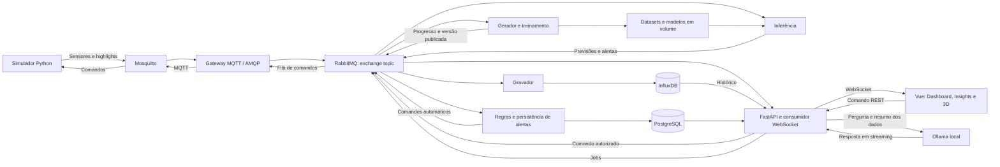

# Contexto do projeto e análise do segundo bimestre

Análise realizada em 08/10/2026. Fonte dos requisitos: `C:\Users\wagne\Downloads\2Bim.MD`. Apresentação prevista no enunciado: **16/11/2026**, com a aplicação funcionando e sem necessidade de slides.

Este documento registra o estado encontrado no código, os requisitos da atividade e uma proposta de evolução. As propostas abaixo ainda não foram implementadas e não representam decisões já aprovadas pelo grupo. O enunciado foi tratado como especificação acadêmica, sem executar ações apenas por estarem descritas nele.

## 1. Problema e solução existentes

O projeto é a **Quadra Inteligente de Beach Tennis — IoT Highlight System**. Seu problema original é facilitar a marcação de jogadas importantes em partidas, evitando procurar manualmente momentos específicos em longas gravações.

A implementação atual registra marcações de highlights. Um botão no ESP32 simulado no Wokwi, ou um script Python, publica um evento no MQTT. O backend salva o evento no InfluxDB e o dashboard apresenta o histórico, a contagem por hora e o estado dos serviços.

**Não existe captura ou recorte real de vídeo no código analisado.** `video_stub.py` monta nomes de arquivos e metadados e escreve logs; não cria um vídeo. O README menciona uma janela de -15 s a +5 s, enquanto o stub retorna duração de 10 s e não implementa essa janela.

Fluxo implementado:

```text
Botão ESP32/Wokwi ou simulate_button.py
    → Mosquitto / quadra/highlight
    → subscriber MQTT dentro do processo FastAPI
    → highlight_service
    → InfluxDB / highlight_events
    → consultas REST a cada 5 segundos
    → Vue 3 / gráfico ECharts / log de eventos
```

## 2. Mapa do código

| Área | Arquivos | Responsabilidade atual |
|---|---|---|
| Inicialização da API | `backend/main.py` | FastAPI, CORS, logging, início do subscriber MQTT e Uvicorn |
| Configuração | `backend/config/settings.py` | Variáveis de ambiente para MQTT, InfluxDB e API |
| API REST | `backend/api/routes.py` | Lista de highlights, estatísticas e health check |
| Entrada MQTT | `backend/mqtt/subscriber.py` | Paho-MQTT em thread, decodificação JSON e chamada da lógica de highlights |
| Negócio | `backend/services/highlight_service.py` | Validação básica, persistência e chamada do stub |
| Persistência | `backend/services/influx_service.py` | Escrita de pontos e consultas Flux no InfluxDB 2.x |
| Vídeo simulado | `backend/services/video_stub.py` | Logs e metadados de uma captura fictícia |
| Tela principal | `frontend/src/views/Dashboard.vue` | Indicadores de highlights, status, gráfico e log |
| Atualização da tela | `frontend/src/composables/useHighlights.ts` | Três consultas HTTP em paralelo a cada 5 s |
| Cliente e contratos | `frontend/src/services/api.ts`, `frontend/src/types/highlight.ts` | Fetch e interfaces TypeScript |
| Componentes | `CourtStatus.vue`, `HighlightChart.vue`, `EventLog.vue` | Estado dos serviços, barras por hora e lista de eventos |
| Aparência | `frontend/src/assets/main.css` | Tema escuro, cores, responsividade e fonte externa |
| Dispositivo | `iot/wokwi/sketch/sketch.ino`, `diagram.json`, `wokwi.toml` | ESP32, botão GPIO 13 e LED GPIO 2; firmware compilado |
| Simulação rápida | `scripts/simulate_button.py` | Publicação de eventos interativos ou automáticos por MQTT |
| Dados de demonstração | `scripts/seed_influx.py` | Cerca de 50 eventos aleatórios históricos, gravados diretamente no InfluxDB |
| Broker | `infra/mosquitto/mosquitto.conf` | MQTT TCP 1883 e MQTT sobre WebSocket 9001, com acesso anônimo |
| Documentação | `README.md`, `docs/architecture.md`, `docs/mqtt-topics.md`, `docs/demo-script.md` | Descrição e demonstração do primeiro bimestre |

Não foram encontrados Dockerfiles, Docker Compose, PostgreSQL, RabbitMQ, autenticação, código de IA, cena 3D, cadastro de dispositivos ou suíte de testes versionada. O frontend monta diretamente uma única tela, sem roteamento entre páginas.

### Contrato e armazenamento atuais

Mensagem MQTT:

```json
{
  "court_id": "court_01",
  "player": "A",
  "event_type": "highlight",
  "timestamp": 1741267800
}
```

No InfluxDB: measurement `highlight_events`, tag `court_id`, fields `player` e `event_type`. A configuração usa organização `smart-court` e bucket `smart_court`. O timestamp persistido atualmente é o instante de processamento, embora o payload possa fornecer outro instante.

Rotas implementadas:

- `GET /api/highlights`: parâmetros `start` e `stop`, limite interno de 100 registros por tabela Flux.
- `GET /api/highlights/stats`: parâmetros `start` e `bucket_interval`.
- `GET /api/health`: teste TCP do broker e health check do InfluxDB.

Não existem rotas para comandos, usuários, dispositivos, regras, jobs ou previsões. O README anuncia filtros `court_id` e `limit` que as rotas atuais não implementam.

## 3. O que muda com a atividade

O novo trabalho mantém o problema e a proposta do primeiro bimestre, mas exige **Web + IoT + inteligência artificial**, incluindo um equipamento que se degrada e permite manutenção preditiva.

A base tecnológica aproveitável é Vue 3 + TypeScript + Vite + ECharts, FastAPI, Paho-MQTT e InfluxDB. Não é necessário migrar para React. Node.js aparece como ferramenta de frontend, não como backend da aplicação.

O novo dispositivo principal deve ser um **simulador Python bidirecional**. O Wokwi pode continuar como referência do primeiro bimestre; o script atual de botão não substitui o simulador completo exigido.

Os comentários antigos que prometem câmera real para o segundo bimestre são expectativas do projeto anterior. **Captura real de vídeo não está listada como requisito obrigatório no novo enunciado.** Preservar os highlights continua necessário; ampliar para vídeo real deve ser uma decisão de escopo separada.

## 4. Comparação com os requisitos

“Existe” significa localizado no código; não significa que o fluxo completo foi demonstrado nesta análise.

| Requisito | Estado encontrado | Evolução necessária |
|---|---|---|
| Mesmo problema do primeiro bimestre | Existe: marcação de highlights de beach tennis | Preservar o fluxo esportivo e conectar a manutenção à infraestrutura da quadra |
| Vue/React + TypeScript + Vite | Existe: Vue 3 | Acrescentar páginas, navegação, sessão e permissões |
| FastAPI + REST | Existe | Ampliar contratos, validação e rotas |
| Gráficos e histórico | Parcial: highlights e contagens | Telemetria, filtros, métricas de IA e histórico por dispositivo |
| WebSocket ao vivo | Ausente; frontend usa polling | Entrega pela API, reconexão e detecção de dados vencidos |
| MQTT com Mosquitto nos dois sentidos | Parcial: envio de highlights | Comandos, confirmação e estado real nas leituras seguintes |
| Três sensores simulados | Ausente como conjunto de telemetria | Sensores contínuos, identificados no cadastro |
| Dois atuadores | Parcial: LED local de confirmação | Atuadores simulados que recebem comandos e afetam as leituras |
| Equipamento com três variáveis medidas | Ausente | Máquina com degradação progressiva e temperatura, corrente e vibração |
| Regra automática | Ausente | Regra no backend com comando pelo barramento |
| Controle manual pela Web | Ausente | Botões autorizados, comandos auditados e confirmação do simulador |
| RabbitMQ | Ausente | Exchange topic, filas, consumidores, jobs, DLQ e usuários por serviço |
| Tela Mensageria | Ausente | API consulta gerenciamento; tela exibe filas, taxas, consumidores e mensagens |
| PostgreSQL | Ausente | Usuários, dispositivos, configurações, regras, alertas e auditoria |
| InfluxDB para telemetria | Parcial: somente highlights | Leituras e histórico; dados de laboratório separados dos dados ao vivo |
| Cadastro de dispositivos | Ausente | Cadastro e gerenciamento persistentes, com IDs compartilhados entre serviços |
| Gêmeo digital 3D | Ausente | Three.js, estados por item, seleção, comandos e ambiente reativo |
| Laboratório com pelo menos 1 milhão de leituras | Ausente; seed tem cerca de 50 eventos | Geração em blocos, configurável e executada por fila |
| Dois modelos de regressão | Ausente | Treino, baseline, métricas, versão e inferência sobre telemetria real |
| Insights e alertas preditivos | Ausente | Saúde, RUL, tendências e alertas com histerese |
| Assistente com LLM local | Ausente | Ollama no Compose, contexto fornecido pelo backend e streaming |
| Segurança exigida | Parcial: `.env` ignorado | JWT, três papéis, bcrypt, limites, ACLs e auditoria |
| Docker Compose com um comando | Ausente | Containers, saúde, dependências, segredos e volumes |
| GitHub e participação do grupo | Remote GitHub configurado | README atualizado e contribuições reais dos integrantes; histórico local encontrado com um nome de autor |

## 5. Proposta de evolução do domínio

Uma opção coerente é manter a **Quadra Inteligente com registro de highlights e monitoramento dos equipamentos que sustentam a gravação e a operação da quadra**.

Equipamento proposto: **ventilador de refrigeração do gabinete do sistema de gravação**. Sua falha pode superaquecer o sistema que mantém o registro das partidas, ligando a manutenção ao problema original.

| Elemento proposto | Função |
|---|---|
| Botão de highlight | Mantém o comportamento central do projeto |
| Sensor de temperatura do gabinete | Alimenta a regra automática de refrigeração |
| Sensor de luminosidade externa | Representa condições da quadra e ilumina o ambiente 3D |
| Temperatura do motor, corrente e vibração do ventilador | Três variáveis para estimar desgaste do equipamento |
| Ventilador | Atuador automático; ao ligar, reduz a temperatura do gabinete e altera corrente/vibração |
| Refletores da quadra | Atuador comandado pelo operador na Web; estado e contribuição à iluminação aparecem na telemetria |
| Dois regressores | Saúde do ventilador de 0 a 100 e vida útil restante em horas |

O simulador deve separar temperatura ambiente, temperatura do gabinete e temperatura do motor. Também deve distinguir luz externa e iluminação produzida pelos refletores, para que o controle tenha efeitos verificáveis.

Na cena 3D: quadra, rede, botão, sensores, gabinete, ventilador e refletores. Dois elementos ambientais podem reagir às leituras: iluminação ambiente pela luminosidade externa e efeito térmico na saída de ar do gabinete pela temperatura medida. A rotação do ventilador, a tremulação por vibração e os refletores acesos complementam esses efeitos.

Essa é uma proposta para discussão com o grupo. Bomba de manutenção da areia ou outro equipamento da quadra também são alternativas, desde que tenham justificativa ligada ao problema original.

## 6. Arquitetura proposta e fluxos



A circulação de eventos IoT, comandos, previsões, alertas e eventos de jobs usa RabbitMQ. Consultas históricas e de cadastro continuam via API e bancos; o assistente recebe um resumo preparado pela API.

Proposta inicial de filas com consumidores independentes: `telemetry.persist`, `telemetry.inference`, `events.websocket`, `device.commands`, `events.rules`, `jobs.generate`, `jobs.train` e `events.dlq`. Usar uma exchange topic e routing keys como `telemetry.court_01.fan.fan_01`, além de tipos para highlights, comandos, previsões e progresso.

Contrato comum de eventos: `id`, `timestamp` UTC, `type`, `device_id` e `payload`, acrescido de `schema_version`, identificação da quadra e correlação entre comando e confirmação. Leituras agrupadas do equipamento devem reunir as três variáveis no mesmo instante, sem rótulos de treino.

MQTT/QoS e reentregas de fila pedem idempotência: consumidores precisam reconhecer o ID para evitar duplicar eventos ou comandos. Comandos devem carregar o estado desejado, por exemplo `on=true`, e a interface deve aguardar confirmação em vez de presumir execução.

PostgreSQL guarda metadados e negócio. InfluxDB guarda séries temporais. Datasets massivos e artefatos de modelos podem ficar em arquivos num volume compartilhado, com metadados/versionamento no PostgreSQL e apenas amostras em um bucket `lab` do InfluxDB.

## 7. Detalhes obrigatórios que podem passar despercebidos

### Dados e modelos

- Laboratório configurável por quantidade de equipamentos e sensores, dias simulados, percentual e modos de falha, ruído, ausências, outliers e semente.
- Pelo menos **1 milhão de leituras**, geração vetorizada em blocos e limite máximo para proteger a máquina. Definir e mostrar a contagem de leituras e de amostras de equipamento.
- Degradação gradual, ciclos diários e sobreposição entre máquinas saudáveis e degradadas. O seed de highlights atual não atende esse objetivo.
- Rótulos de degradação e tempo até a falha ficam exclusivamente no dataset de treino. Nenhum rótulo, nível interno de desgaste ou contador que revele a falha pode virar feature da inferência.
- Features calculadas por um único módulo compartilhado; janelas somente com leituras passadas.
- Treino, validação e teste separados **por equipamento**, nunca por linhas aleatórias da mesma máquina.
- Pelo menos dois regressores: saúde e RUL são alvos adequados à proposta. Classificação é complementar.
- MAE, RMSE, R², previsto contra real, importância das features e comparação com a previsão da média. Os modelos devem vencer a base simples nos conjuntos separados.
- Jobs por RabbitMQ, progresso pela interface e ativação de nova versão sem reiniciar a inferência. Versionar também o contrato de features e os parâmetros de pré-processamento.
- Definir tratamento de sensores ausentes, janela ainda incompleta e equipamento desligado. Um ventilador parado não deve receber saúde artificialmente ótima só porque corrente e vibração caíram.
- Alertas com persistência e histerese: por exemplo, três previsões críticas para abrir e dez normais para limpar.

### Cena 3D e mensageria

- A cena recebe estado somente pelo WebSocket da API. Ela deve parar suas animações dependentes do dispositivo e sinalizar ausência de dados quando a telemetria vencer, mesmo que a conexão WebSocket permaneça aberta.
- Sensores, atuadores e equipamento aparecem com os mesmos IDs do cadastro. Posições 3D ficam apenas no frontend.
- Cores normal/atenção/crítico/sem dados; painel de seleção com leitura, mini gráfico, saúde e comandos permitidos.
- Dois elementos do ambiente reagem a dados reais; animações de atuadores seguem seu estado confirmado. Conexões devem terminar nos equipamentos.
- Store compartilhado para Dashboard, Insights e 3D; atualização dos valores no loop sem reconstruir toda a cena por mensagem.
- RabbitMQ: exchange topic, pelo menos quatro consumidores distintos, filas dos jobs, DLQ preservando o conteúdo e usuário por serviço com permissões mínimas, sem `guest`.
- Mensageria mostra filas, taxas, consumidores, últimas mensagens e DLQ. Somente o backend consulta a API de gerenciamento.
- Demonstrar um consumidor parado acumulando mensagens e, depois, drenando a fila ao voltar.

### Assistente, segurança e execução

- Ollama ou equivalente local em container, com modelo pequeno para CPU; sem APIs de LLM em nuvem.
- Backend fornece últimas leituras, saúde, RUL, alertas, métricas e contexto da arquitetura. LLM não acessa bancos diretamente; eventuais ferramentas são fixas e somente leitura.
- Streaming, indicação de carregamento e pré-carregamento do modelo para a apresentação.
- Texto/Markdown sem HTML nem imagens remotas, limite de perguntas por usuário e registro na auditoria.
- JWT e papéis visualizador, operador e administrador; bcrypt e limite de tentativas de login.
- Segredos gerados por script em arquivos ignorados pelo Git; usuários de demonstração documentados sem senhas.
- MQTT sem anônimos e com ACL por tópico; AMQP com credenciais por serviço.
- WebSocket com ticket curto de uso único, sem JWT na URL.
- Containers da aplicação sem root; apenas a porta do frontend publicada para a aplicação, usando proxy para REST e WebSocket.
- Interfaces administrativas dos bancos/broker podem ser publicadas apenas em `127.0.0.1`, com links na aplicação.
- Compose inclui frontend, API, gateway, simulador, brokers, bancos, geração, treino, inferência e LLM; healthchecks, volumes e ordem correta de inicialização.
- O enunciado recomenda pelo menos 8 GB para Docker/WSL2. A obtenção inicial do modelo deve fazer parte do bootstrap; um cache pré-existente não pode ser a única forma de subir em outra máquina.

## 8. Problemas concretos da base atual

1. **Timestamp ignorado na persistência:** `write_highlight()` usa `datetime.now()` em vez do instante do evento. Uma verificação isolada com timestamp `0` confirmou que o ponto recebe a hora atual. Isso prejudica histórico e ordenação.
2. **Possível sobrescrita de highlights:** pontos da mesma measurement/tag com precisão de segundos têm a mesma identidade quando chegam no mesmo segundo. O esquema precisa preservar eventos distintos e seus IDs.
3. **KPIs com nomes imprecisos:** “Highlights hoje” soma uma janela móvel de 24 h; “Última hora” conta os registros retornados, sujeitos ao limite da consulta. O jogador líder também se baseia nessa lista limitada.
4. **Histórico limitado e filtros incompletos:** limite aplicado por tabela Flux, sem paginação, filtro de quadra ou ordenação global após concatenar tabelas. A documentação anuncia parâmetros não implementados.
5. **Validação fraca:** o serviço só verifica presença de três campos; não tipa valores, não restringe eventos/jogadores e não valida timestamp. As consultas interpolam parâmetros diretamente no texto Flux.
6. **Falhas de processamento sem recuperação durável:** gravação síncrona no callback MQTT; erros são registrados em log, sem DLQ nem mecanismo de reprocessamento no código.
7. **Broker pode impedir startup:** `client.connect()` acontece antes de iniciar a thread e não tem proteção para indisponibilidade inicial; shutdown também não encerra explicitamente os clientes.
8. **Health check superficial do MQTT:** porta TCP aberta não comprova que o subscriber está conectado, autenticado e recebendo mensagens.
9. **QoS diferente da documentação:** script Python publica com QoS 1, mas subscribe usa padrão QoS 0 e o sketch chama publish sem configurar QoS 1.
10. **Sem retorno Web → IoT:** o LED reage localmente ao botão, sem comandos do backend. A porta 9001 é transporte MQTT sobre WebSocket, não o WebSocket de atualização exigido para a aplicação.
11. **Diferenças nos documentos antigos:** README cita `localhost` para o sketch, mas ele usa `host.wokwi.internal`; a arquitetura lista versões antigas em relação aos manifests; o roteiro mostra SQL para um código que usa Flux no InfluxDB 2.x.
12. **Acesso anônimo ao MQTT:** configuração atual diverge da segurança exigida. `.env` ignorado é uma base útil, mas não substitui autenticação, papéis, ACLs e auditoria.

Esses achados são diagnóstico. Não foram corrigidos durante a análise.

## 9. Ordem sugerida de implementação

1. **Fechar o cenário:** manter highlights e escolher equipamento, sensores, atuadores, unidades, modos de falha e efeitos físicos. Definir IDs e contratos de telemetria/comando.
2. **Infraestrutura e segurança inicial:** Compose, proxy, bancos, brokers, segredos, autenticação, papéis e cadastro. Corrigir persistência dos highlights ao adaptar o gravador.
3. **Fluxo bidirecional completo:** simulador → MQTT → gateway → RabbitMQ → persistência/inferência/API; comando Web → API → RabbitMQ → gateway → MQTT → simulador → confirmação. Incluir regra automática.
4. **Interface operacional:** Dashboard por WebSocket, histórico, dispositivos, Mensageria e auditoria. Demonstrar acúmulo e drenagem de fila antes de avançar para IA.
5. **Laboratório e treinamento:** gerador massivo, datasets rotulados, features compartilhadas, separação por máquina e dois modelos que vencem a baseline.
6. **Inferência e Insights:** previsões ao vivo, histerese, versão em uso e injeção de falha física no simulador, sem enviar seus rótulos ao modelo.
7. **Gêmeo digital:** reutilizar o estado já validado; seleção, ambiente, animações e interrupção quando faltarem dados.
8. **Assistente local e demonstração:** resumo contextual, streaming, limites e auditoria; validar bootstrap em ambiente limpo e ensaiar os 12 passos do enunciado.

Páginas previstas: Login, Dashboard/Highlights, Dispositivos, Gêmeo Digital, Mensageria, Laboratório de Dados, Treinamento, Insights, Assistente e Administração/Auditoria. Podem ser agrupadas em navegação, mantendo todos os comportamentos exigidos.

## 10. Verificações realizadas e limites

- Lidos os arquivos de código da aplicação, scripts, configuração de infraestrutura e documentação, além do enunciado completo. Manifests e configurações de build foram examinados; firmware compilado não foi executado.
- Árvore Git inicialmente sem alterações; remote configurado para `https://github.com/RaFaSMK/IOT.git`. O histórico local apresentou o nome de autor `RafaSMK`; isso não prova a participação real de todos os integrantes nem verifica o estado remoto do GitHub.
- `npm run build`: **aprovado**, incluindo `vue-tsc --build`. Há aviso de bundle JavaScript acima de 500 kB, sem falha de build.
- Sintaxe Python: **14 arquivos aprovados**. Importação da API e geração do OpenAPI também funcionaram no ambiente virtual existente.
- Persistência verificada com escrita mockada, sem gravar dados: confirmado que o timestamp do payload é ignorado.
- Na checagem local, porta MQTT 1883 aberta; portas 8086, 8000 e 5173 fechadas. Não foi demonstrado o pipeline ponta a ponta.
- Docker CLI disponível, mas o daemon do Docker Desktop não respondeu. Não há Compose no repositório para validar.
- A única alteração de conteúdo desta análise é este documento. O build produziu seus artefatos locais ignorados pelo Git. Nenhuma integração nova foi implementada, nenhum serviço foi iniciado e nenhum evento de teste foi enviado ao broker ou ao banco.

Conclusão: a base do primeiro bimestre é aproveitável, mas o segundo exige uma ampliação arquitetural significativa. O núcleo da evolução é ligar sensores e comandos a uma máquina com degradação, passando pelo RabbitMQ, usando dois modelos reais de regressão e refletindo o estado na Web, no 3D e no assistente local.
