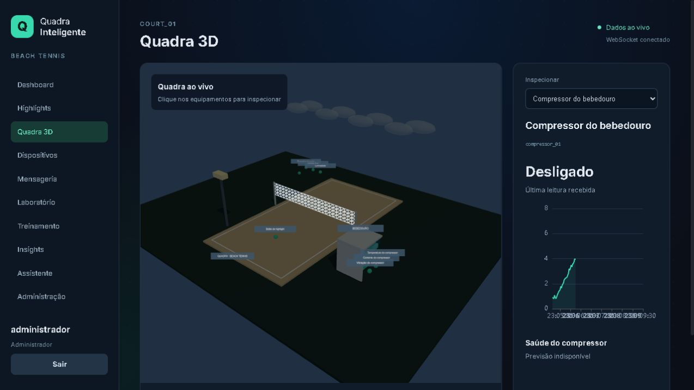
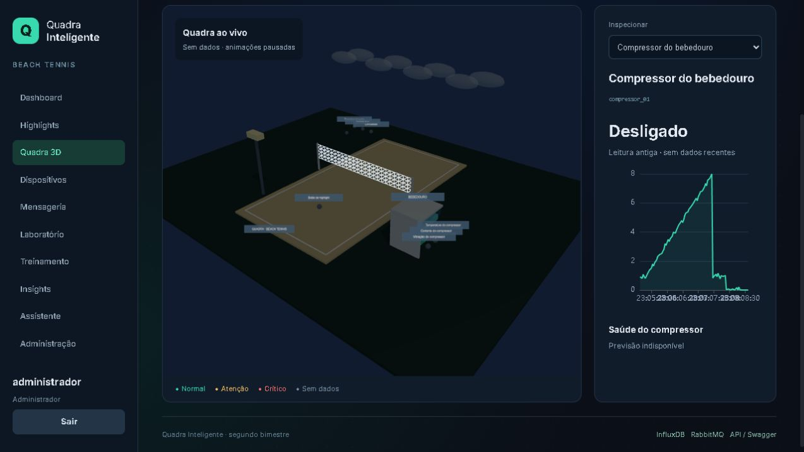
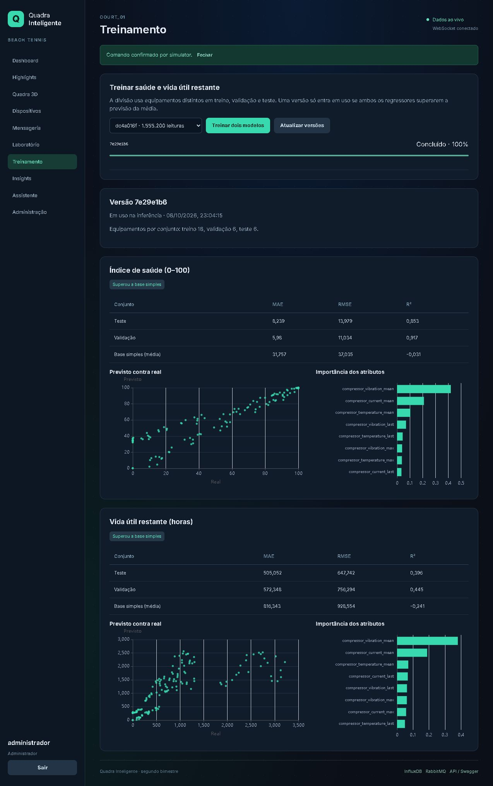

# Validação da versão AIoT

Verificação realizada em 08/10/2026, no Windows com Docker Desktop/WSL2. Todos os serviços permanentes chegaram ao estado saudável; bootstrap, inicialização do banco e download/aquecimento do modelo encerraram com código zero.

## Resultados

| Verificação executada | Resultado |
| --- | --- |
| Nove testes unitários Python | Passaram |
| Build Vue/TypeScript nos containers | Passou |
| Auditoria npm | Zero vulnerabilidades na execução |
| Login dos três papéis e bloqueios 403 | Passou |
| Web → RabbitMQ → MQTT → refletores → confirmação e telemetria por WebSocket | Passou |
| Reutilização de ticket WebSocket | Rejeitada com 403 |
| Highlights e histórico dos sensores no InfluxDB | Persistência consultada pela API |
| Oito filas RabbitMQ, sete com consumidores distintos | Confirmado |
| Gravador parado/religado | Fila acumulou 11 mensagens e depois voltou a zero, com consumidor conectado |
| Mensagem JSON fora do contrato | Encaminhada à DLQ; duas consultas mantiveram o conteúdo |
| Geração configurável pelo job RabbitMQ | 1.555.200 leituras, 518.400 amostras |
| Treino pelo job RabbitMQ | Dois regressores concluídos e ativados |
| Split por equipamento | 18 treino, 6 validação, 6 teste, sem interseção |
| Regra de refrigeração automática | Compressor religou após comando manual de desligamento e condição de temperatura |
| Inferência com versão do modelo | Previsões reais recebidas pelo WebSocket |
| Falha injetada no compressor | Gerou alerta persistido, entregue pelo WebSocket |
| Reset da falha | Alerta resolvido após sequência de recuperação |
| Ollama local CPU | Download/aquecimento e resposta sobre alerta em streaming concluídos |
| Quadra 3D | Cena WebGL e painel com leitura/gráfico observados no navegador |
| Ausência de telemetria com WebSocket ainda conectado | Cena indicou sem dados e animações pausadas após dez segundos |

Dataset: `dc4a016f-...`. Versão de treino: `7e29e1b6-2b6d-46cd-a410-ffc3077d9c7b`. Identificadores são gerados novamente quando os testes criam outros jobs.

## Métricas reais

| Alvo | MAE teste | RMSE teste | R² teste | MAE baseline | RMSE baseline |
| --- | ---: | ---: | ---: | ---: | ---: |
| Saúde (0–100) | 8,239 | 13,979 | 0,853 | 31,757 | 37,035 |
| RUL (horas) | 505,052 | 647,742 | 0,396 | 816,343 | 928,554 |

Ambos superaram a baseline da média. A RUL ainda apresenta erro alto; os resultados pertencem ao cenário sintético e não demonstram precisão em equipamento real. O assistente usa um modelo pequeno e suas explicações precisam ser conferidas com os indicadores; os limites violados são incluídos explicitamente no resumo fornecido pelo backend.

## Evidências da interface

## Reproduzir

Consulte [implementacao-2bim.md](implementacao-2bim.md). `scripts/check_integration.py` verifica permissões, fluxo de comando, histórico, filas, geração e treino. `scripts/check_live.py` verifica DLQ e, no modo live, regra, falha, alerta, resposta do LLM e recuperação. Esses scripts criam eventos e jobs no ambiente de demonstração.

A inspeção da interface foi feita com a aplicação servida pelo nginx, usando login de administrador. Não houve teste em compressor físico, ensaio de carga de produção nem verificação de hardware IoT real, que foi substituído pelo simulador conforme o enunciado.
